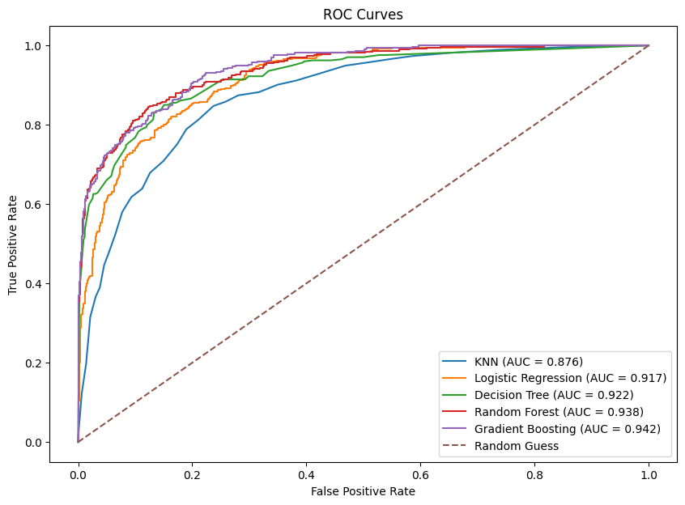

# Telecom Customer Churn Prediction

I built and compared models to predict which customers might cancel their telecom service, which is also known as **churn**. The goal was to help the company come up with ways to keep its customers.

**Project Type:** Classification, which means predicting a category. In this case, it refers to whether a customer stays or leaves.

**Tools:** Python, Pandas, NumPy, scikit-learn, Matplotlib, Seaborn, Google Colab

## Main Result

I chose Gradient Boosting as the final model. The default cutoff of **0.50** was used to flag customers who might leave, which gave the following test results:

| Metric | Result |
| --- | ---: |
| Accuracy | 88.8% |
| Precision | 86.5% |
| Recall | 71.9% |
| F1-score | 0.785 |
| ROC-AUC | 0.942 |

**Precision** shows how often the model was correct when it flagged a customer as being likely to leave. **Recall** shows the percentage of customers who actually left that the model was able to identify correctly. The model was able to identify **269 out of the 374 customers who left** in the test data.



## Business Question

Which customers are most likely to leave, and what could the company do to encourage them to stay?

## Data Source

This project uses the [Telecom Customer Churn Dataset From Maven Analytics](https://mavenanalytics.io/data-playground/telecom-customer-churn). It contains customer information for a fictional telecom in California during the second quarter of 2022. Maven Analytics lists IBM Cognos Analytics as the original source.

The file used in this project is `telecom_customer_churn.csv`, which contains **7,043 customer records and 38 columns**.

## Workflow

- Removed recently joined customers, which resulted in 6,589 customers who had either stayed or churned.
- Checked missing values and filled service-related gaps based on whether each customer had that service.
- Removed customer IDs, location columns, and information that already revealed whether a customer had left.
- Converted categories into numbers the models could use.
- Used 80% of the data to train the models and 20% to test them. Both groups had a similar share of customers who stayed and left. Used `random_state=2026` so the split could be repeated.
- Compared KNN, Logistic Regression, Decision Tree, Random Forest, and Gradient Boosting.
- Used five-fold cross-validation to compare model settings by training and checking each model five times, using a different group of data for validation each time.
- Explored how changing the cutoff affected the number of customers correctly identified as churning and the number incorrectly flagged.

## Model Comparison

The table below shows the test results for the model versions included in the final comparison.

| Model | Accuracy | Precision | Recall | F1-score | ROC-AUC |
| --- | ---: | ---: | ---: | ---: | ---: |
| KNN | 0.810 | 0.653 | 0.709 | 0.679 | 0.876 |
| Logistic Regression | 0.856 | 0.751 | 0.735 | 0.743 | 0.917 |
| Decision Tree | 0.867 | 0.818 | 0.684 | 0.745 | 0.922 |
| Random Forest | 0.885 | 0.861 | 0.711 | 0.779 | 0.938 |
| Gradient Boosting | 0.888 | 0.865 | 0.719 | 0.785 | 0.942 |

## Key Findings

- Customers who had been with the company for less time were more likely to leave.
- Customers with month-to-month contracts had higher churn rates.
- Customers without Online Security or Premium Tech Support also had higher churn rates.
- About 45% of reported churn involved competitor-related reasons.

These findings suggest that the company could pay more attention to keeping newer customers, look for ways to improve its services, and see how its offers compare with competitors’ offers.

Lowering the cutoff from **0.50 to 0.45** helped the model find nine more customers who had left in the test data. However, it also mistakenly labeled more customers who stayed as being likely to leave. This lowered precision to **82.5%**. I kept **0.50** as the final cutoff.

## Files

- [Full Notebook](telecom_customer_churn_prediction.ipynb): The project’s code, explanations, charts, and saved results.
- [Data Instructions](DATA.md): Where the data came from and which data file to download.
- `requirements.txt`: A list of Python packages and suggested version ranges for running the project.
- `images/`: Charts saved from the notebook.

## How to Run in Google Colab

1. Open [Google Colab](https://colab.research.google.com/). Choose **File > Upload notebook** and select `telecom_customer_churn_prediction.ipynb`.
2. Download `telecom_customer_churn.csv` by following the instructions in [DATA.md](DATA.md).
3. In Colab’s **Files** panel, upload the CSV to the `/content` folder. Keep the filename the same so the notebook can find it.
4. Run the notebook cells from top to bottom.

Colab runs the notebook in your browser, so you do not need to install or open Jupyter on your computer.

If a Python package is missing or does not work with the notebook, upload `requirements.txt` to Colab’s `/content` folder. Add a new code cell at the top of the notebook and run:

```python
%pip install -r requirements.txt
```

If Colab asks you to restart, do so, then run the notebook cells again from top to bottom. The suggested package versions still need to be checked together to confirm that the setup works.

**Files uploaded to Colab are temporary**. You may need to upload your CSV again when you start a new session.

You can also view the saved results on GitHub without downloading the data or running the notebook.

## Limits and Next Steps

This project uses historical data from a fictional company. The patterns found do not prove what causes customers to leave or whether contacting them would prevent cancellations.

I used the test results to help choose the final model and cutoff. This means the results may make the model look better than it would on new data. In the future, I would use the training data and cross-validation to make these choices, then test the chosen model on data that had not been used before.

Before using the model to predict which customers might leave, I would also check that the information needed to make those predictions would be available before they cancel.
